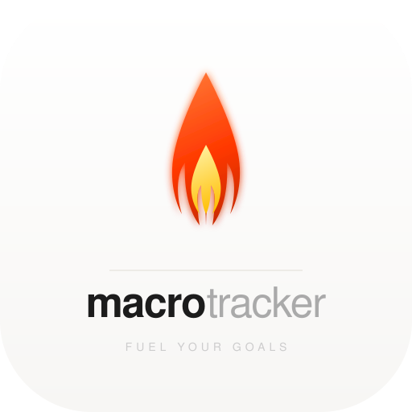

<p align="center">
  
</p>

<h1 align="center">MacroTrackr</h1>

<p align="center">
  <strong>Self-hosted, privacy-first macro nutrition tracker</strong><br>
  Barcode scanning &bull; Multi-provider AI &bull; Installable PWA
</p>

<p align="center">
  
    
  
</p>

<p align="center">
  
  
  
  
  
</p>

---

## What is MacroTrackr?

A complete nutrition tracking app you host yourself. Scan barcodes, search foods, log meals, and let AI generate personalized macro plans — all with your data staying on your server.

### Highlights

- **Scan & Search** — Camera barcode scanning, manual entry, OpenFoodFacts + USDA database lookup
- **Smart Logging** — Log by meal type with quick-add suggestions based on your eating habits
- **Macro Rings** — Interactive dashboard with progress rings, streak tracking, and shareable images
- **AI-Powered** — Generate macro plans, meal plans, scan nutrition labels, or estimate food macros with OpenAI, Anthropic, or Gemini (bring your own key)
- **Body Tracking** — Weight, body fat %, measurements with trend charts
- **Progress Photos** — Encrypted photo storage with lightbox viewer
- **PWA** — Install on any device, works offline

---

## Quick Start

### Option A: Docker Compose (Recommended)

Pre-built images from Docker Hub — no build step required.

**1. Create project directory**

```bash
mkdir macrotracker && cd macrotracker
```

**2. Create `docker-compose.yml`**

```yaml
services:
  db:
    image: postgres:17-alpine
    restart: unless-stopped
    environment:
      POSTGRES_USER: macrotracker
      POSTGRES_PASSWORD: ${POSTGRES_PASSWORD:-changeme}
      POSTGRES_DB: macrotracker
    volumes:
      - pg_data:/var/lib/postgresql/data
    healthcheck:
      test: ["CMD-SHELL", "pg_isready -U macrotracker"]
      interval: 10s
      timeout: 5s
      retries: 5

  redis:
    image: redis:7-alpine
    restart: unless-stopped
    volumes:
      - redis_data:/data
    healthcheck:
      test: ["CMD", "redis-cli", "ping"]
      interval: 10s
      timeout: 5s
      retries: 5

  api:
    image: geaves006/macrotrackr-api:latest
    restart: unless-stopped
    depends_on:
      db:
        condition: service_healthy
      redis:
        condition: service_healthy
    environment:
      NODE_ENV: production
      DATABASE_URL: postgresql://macrotracker:${POSTGRES_PASSWORD:-changeme}@db:5432/macrotracker
      REDIS_URL: redis://redis:6379
      JWT_SECRET: ${JWT_SECRET}
      JWT_REFRESH_SECRET: ${JWT_REFRESH_SECRET}
      ENCRYPTION_KEY: ${ENCRYPTION_KEY}
      FRONTEND_URL: ${FRONTEND_URL:-http://localhost:3000}
      API_BASE_URL: ${API_BASE_URL:-http://localhost:4000}
      API_PORT: 4000
      GOOGLE_CLIENT_ID: ${GOOGLE_CLIENT_ID:-}
      GOOGLE_CLIENT_SECRET: ${GOOGLE_CLIENT_SECRET:-}
      USDA_FDC_API_KEY: ${USDA_FDC_API_KEY:-}
    ports:
      - "${API_PORT:-4000}:4000"

  web:
    image: geaves006/macrotrackr-web:latest
    restart: unless-stopped
    depends_on:
      - api
    environment:
      NEXT_PUBLIC_API_URL: ${NEXT_PUBLIC_API_URL:-http://localhost:4000/api/v1}
    ports:
      - "${WEB_PORT:-3000}:3000"

volumes:
  pg_data:
  redis_data:
```

**3. Create `.env`**

```env
# Required — generate with: openssl rand -hex 32
JWT_SECRET=<random-string-at-least-32-chars>
JWT_REFRESH_SECRET=<another-random-string>
ENCRYPTION_KEY=<64-hex-char-string-for-aes-256>
POSTGRES_PASSWORD=<strong-db-password>

# URLs — change for production / reverse proxy
FRONTEND_URL=http://localhost:3000
API_BASE_URL=http://localhost:4000
NEXT_PUBLIC_API_URL=http://localhost:4000/api/v1

# Optional — Google OAuth
GOOGLE_CLIENT_ID=
GOOGLE_CLIENT_SECRET=

# Optional — USDA food database
USDA_FDC_API_KEY=
```

> **Tip:** Generate all secrets at once:
> ```bash
> echo "JWT_SECRET=$(openssl rand -hex 32)"
> echo "JWT_REFRESH_SECRET=$(openssl rand -hex 32)"
> echo "ENCRYPTION_KEY=$(openssl rand -hex 32)"
> echo "POSTGRES_PASSWORD=$(openssl rand -hex 16)"
> ```

**4. Start**

```bash
docker compose up -d
```

Open `http://localhost:3000` and create your account.

**Update to latest:**

```bash
docker compose pull && docker compose up -d
```

---

### Option B: Portainer Stack

If you use Portainer to manage Docker:

1. Go to **Stacks** > **Add stack**
2. Name it `macrotracker`
3. Paste the `docker-compose.yml` contents from above into the **Web editor**
4. Scroll down to **Environment variables** and add each `.env` variable:

   | Name | Value |
   |------|-------|
   | `JWT_SECRET` | *(output of `openssl rand -hex 32`)* |
   | `JWT_REFRESH_SECRET` | *(output of `openssl rand -hex 32`)* |
   | `ENCRYPTION_KEY` | *(output of `openssl rand -hex 32`)* |
   | `POSTGRES_PASSWORD` | *(strong password)* |
   | `FRONTEND_URL` | `https://macros.yourdomain.com` |
   | `API_BASE_URL` | `https://macros-api.yourdomain.com` |
   | `NEXT_PUBLIC_API_URL` | `https://macros-api.yourdomain.com/api/v1` |

5. Click **Deploy the stack**

> **Updating:** In Portainer, go to your stack > click **Pull and redeploy** to grab the latest images.

---

## Features

<table>
<tr>
<td width="50%">

### Tracking
- Barcode scanning (camera + manual)
- Food search (local DB + USDA + OpenFoodFacts)
- Meal logging (breakfast, lunch, dinner, snack)
- Adjustable serving sizes with +/- stepper
- Real-time macro totals
- Fuzzy search with special character stripping
- Food log export (CSV)

</td>
<td width="50%">

### AI-Powered
- Personalized macro plan generation
- Structured meal plans (1/3/7 day)
- Nutrition label photo scanning
- Food macro estimation from text
- Multi-provider: OpenAI, Anthropic, Gemini
- Bring your own API key (encrypted at rest)

</td>
</tr>
<tr>
<td>

### Body & Progress
- Weight tracking with auto-sync to profile
- Body measurements (12 body parts)
- Body fat % and lean mass tracking
- Progress photos (encrypted storage)
- Trend charts (nutrition + body)
- Streak tracking

</td>
<td>

### User Experience
- Progressive Web App (installable)
- Dark mode (system-aware + manual)
- Imperial & metric units
- Guided onboarding tutorial
- Shareable macro ring images (3x DPI)
- Smart quick-add (learns your habits)
- Passkey authentication support

</td>
</tr>
</table>

---

## Tech Stack

| Layer | Technology |
|:------|:-----------|
| **Frontend** | Next.js 15 (App Router), React 19, Tailwind CSS 4, TanStack Query v5 |
| **Backend** | Fastify 5, Prisma 6, PostgreSQL 17, Redis 7 |
| **AI** | OpenAI, Anthropic, Google Gemini (user-provided keys) |
| **Food Data** | OpenFoodFacts API v2, USDA FoodData Central |
| **Auth** | JWT (access + refresh), Google OAuth, Passkeys (WebAuthn) |
| **PWA** | @serwist/next (service worker, precaching, offline shell) |
| **Monorepo** | pnpm 10 workspaces, Turborepo |
| **Deploy** | Docker Compose, GitHub Actions CI/CD |

---

## Architecture

```
                    ┌──────────────┐
                    │   Browser    │
                    │  (PWA/Web)   │
                    └──────┬───────┘
                           │
              ┌────────────┴────────────┐
              │                         │
       ┌──────▼──────┐          ┌──────▼──────┐
       │  Next.js 15 │          │  Fastify 5  │
       │   :3000     │          │   :4000     │
       │  (frontend) │─────────▶│   (API)     │
       └─────────────┘          └──────┬──────┘
                                       │
                          ┌────────────┼────────────┐
                          │            │            │
                   ┌──────▼───┐ ┌─────▼────┐ ┌─────▼─────┐
                   │ Postgres │ │  Redis   │ │ AI APIs   │
                   │   :5432  │ │  :6379   │ │ (OpenAI,  │
                   │  (data)  │ │ (cache/  │ │ Anthropic,│
                   └──────────┘ │  tokens) │ │ Gemini)   │
                                └──────────┘ └───────────┘
```

---

## Project Structure

```
MacroTracker/
├── packages/
│   ├── shared/            # Types, Zod schemas, constants
│   ├── api/               # Fastify backend
│   │   ├── prisma/        #   Schema & migrations
│   │   └── src/
│   │       ├── plugins/   #   Auth, Prisma, Redis
│   │       ├── routes/    #   API route handlers
│   │       ├── services/  #   Business logic
│   │       └── utils/     #   Encryption, errors, helpers
│   └── web/               # Next.js frontend
│       └── src/
│           ├── app/       #   Route groups: (auth), (dashboard)
│           ├── components/ #   UI, scanner, log, plan components
│           ├── providers/  #   Auth, Query, Theme providers
│           └── lib/       #   API client, utilities
├── docker-compose.yml
├── docker-compose.dev.yml
└── turbo.json
```

---

## Development Setup

### Prerequisites

- [Node.js 22+](https://nodejs.org/)
- [pnpm 10+](https://pnpm.io/)
- [Docker & Docker Compose](https://docs.docker.com/get-docker/)

### Getting started

```bash
git clone https://github.com/stevegee006/MacroTrackr.git
cd MacroTrackr
pnpm install
cp .env.example .env   # Edit with your secrets
```

### Run with Docker (build from source)

```bash
docker compose up --build
```

### Run with hot reload

```bash
docker compose -f docker-compose.yml -f docker-compose.dev.yml up
```

### Run without Docker

Start PostgreSQL and Redis separately, then:

```bash
pnpm db:migrate    # Run Prisma migrations
pnpm db:seed       # Seed sample food data (optional)
pnpm dev           # Start all services via Turborepo
```

### Commands

| Command | Description |
|:--------|:------------|
| `pnpm dev` | Start all packages in dev mode |
| `pnpm build` | Build all packages |
| `pnpm lint` | Lint all packages |
| `pnpm db:migrate` | Run Prisma migrations |
| `pnpm db:push` | Push schema to database |
| `pnpm db:seed` | Seed sample food items |
| `pnpm db:studio` | Open Prisma Studio GUI |

---

## Database Models

| Model | Description |
|:------|:------------|
| **User** | Auth credentials, display name, OAuth/passkey providers |
| **UserProfile** | Height, weight, age, birthday, sex, activity level, goal, macro targets |
| **UserSettings** | Encrypted AI keys, preferred provider, units, dark mode, timezone |
| **FoodItem** | Nutrition per 100g, barcode, brand, source |
| **FoodLog** | Daily entries with pre-computed totals, grouped by meal type |
| **BodyMeasurement** | Weight, body fat %, lean mass, 12 circumference measurements |
| **ProgressPhoto** | Encrypted file paths, date, notes |
| **MacroPlan** | AI or manual calorie/macro targets |
| **MealPlan** | Structured JSON with daily meals, recipes, and macros |

---

## CI/CD

GitHub Actions automatically builds and pushes Docker images on every push to `main`:

| Image | Description |
|:------|:------------|
| `geaves006/macrotrackr-api:latest` | Fastify API (runs migrations on startup) |
| `geaves006/macrotrackr-web:latest` | Next.js standalone build |

---

## License

MIT
